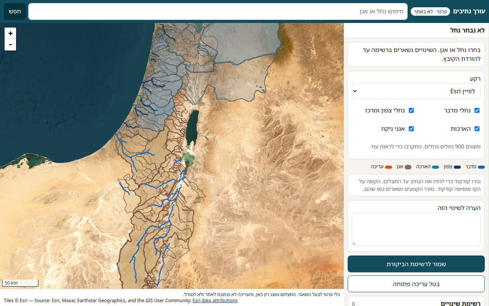
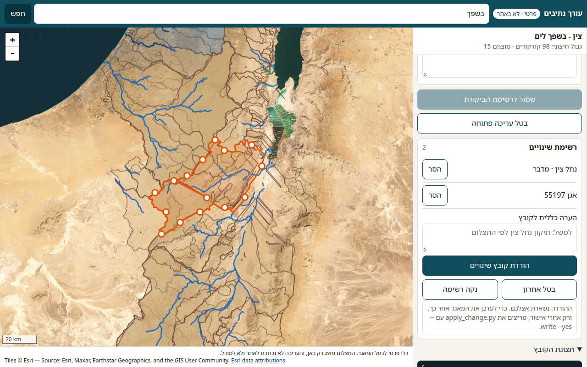
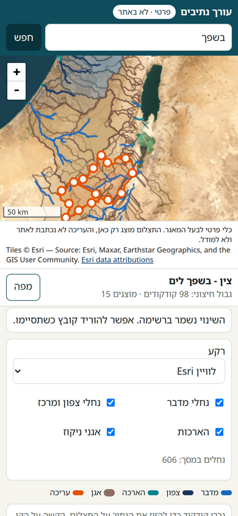

# עורך נתיבים (פרטי)

כלי מקומי לאיל, בעל המאגר. הוא לא חלק מהאתר הציבורי, ו-GitHub Pages מפרסם רק את התיקייה `site/`. אין קישור אליו מ-`site/index.html`.

העורך מציג את הנחלים ואת אגני הניקוז על תצלום לוויין חינמי, ושומר את העריכה כקובץ ביקורת. הוא לא כותב ל-GeoJSON, לא למודל ולא לאתר.

## פתיחה

מהשורש של המאגר:

```bash
python3 tools/stream_editor/server.py
```

נפתח בדפדפן: <http://127.0.0.1:8765/>

השרת מאזין רק ל-`127.0.0.1`. לטלפון באותה רשת אלחוטית:

```bash
python3 tools/stream_editor/server.py --host 0.0.0.0 --port 8765
```

ואז בטלפון: `http://<כתובת-המחשב>:8765/`. אל תפתחו את הפורט לאינטרנט. זה לא האתר הציבורי.

אפשר גם Sentinel-2 ללא עננים (EOX) במקום Esri. ברירת המחדל היא Esri World Imagery, כי אפשר להתקרב יותר.

## שימוש

1. מחפשים נחל או אגן. הנחלים הגדולים מופיעים מרחוק; מתקרבים כדי לראות קטעים קטנים.
2. גוררים קודקוד כדי להזיז את הנתיב על התצלום. הקשה על הקו מוסיפה קודקוד.
3. **הארך** מוסיף קודקוד בקצה. **קצר** מוריד קודקוד קצה. חייבים להישאר לפחות שני קודקודים.
4. **מזג עם נחל אחר** מחבר שני קטעים מאותה שכבה. המזהה של הנחל הראשון נשאר. המזהה של הנחל השני לא נמחק ולא ממספר מחדש את השאר; בקובץ הביקורת הוא מסומן כנבלע.
5. בוחרים אגן וגוררים את הגבול החיצוני. חורים פנימיים נשמרים. **שייך לאגן שנבחר** משנה רק את תווית האגן של הנחל.
6. כותבים הערה קצרה ולוחצים **שמור לרשימת הביקורת**. **הורדת קובץ שינויים** מוריד JSON למכשיר. הרשימה נשמרת רק בלשונית, עד שסוגרים אותה.

הקובץ הוא `geometry-review-YYYYMMDD-HHMM.json`. לכל שינוי יש `op`, מזהה, הערה, וגיאומטריה ישנה וחדשה.

| `op` | משמעות |
| --- | --- |
| `update_stream` | נתיב ו/או שיוך אגן |
| `merge_streams` | שני קטעים לקטע אחד, בלי מזהה חדש |
| `update_basin` | גבול אגן |

## אחרי אישור

הסקריפט לא רץ לבד. בלי `--write` וגם `--yes` הוא רק מדפיס מה היה משתנה:

```bash
python3 tools/stream_editor/apply_change.py geometry-review-YYYYMMDD-HHMM.json --repo .
python3 tools/stream_editor/apply_change.py geometry-review-YYYYMMDD-HHMM.json --repo . --write --yes
```

כשמחילים קובץ מאושר, הוא מעדכן את עותקי התצוגה (`site/data/` ו-`data/` כשהקטע קיים שם) ואת `coords` / `coords_display` בטבלת הקטעים. הוא לא משנה `lat`, `lon`, תאי גשם, זמני זרימה, שטח, CN, קבצי `model/`, כיול או ספים. מזהי הקטעים נשארים באותו סדר. קטע שנבלע במיזוג נשאר בטבלה עם `hidden: 1`.

אם הגיאומטריה הישנה בקובץ לא תואמת את הקובץ באתר, לא נכתב כלום.

העורך לא כולל את קווי הפלגים בלי מזהה (`small_streams_*.geojson`). אין להם מזהה יציב.

## תצלום

רק בתוך הכלי הזה:

- Esri World Imagery. יש לתת קרדיט: Tiles © Esri — Source: Esri, Maxar, Earthstar Geographics, and the GIS User Community.
- Sentinel-2 cloudless מאת EOX (CC BY 4.0), נתוני Copernicus Sentinel.

אין כאן MAPI, GovMap או מקור סגור אחר.

## צילומי מסך

מסך 1280: נחלים ואגנים על הלוויין, והפאנל בעברית.



אחרי הזזת נחל ועריכת גבול אגן. הרשימה מחזיקה את שני השינויים.



מסך 390: אותו כלי בטלפון. «כלים» פותח את הגיליון, והמפה והקרדיט נשארים גלויים.



---

# Stream path editor (private)

Local tool for Eyal, the repo owner. It is not part of the public site. GitHub Pages publishes `site/` only, and `site/index.html` does not link here.

The editor draws the channel segments and drainage basins on a free satellite image. Edits are downloaded as a review file. Nothing is written into the GeoJSON, the model, or the site.

## Open it

From the repo root:

```bash
python3 tools/stream_editor/server.py
```

Open <http://127.0.0.1:8765/>. The default bind is `127.0.0.1` only. For a phone on the same Wi-Fi:

```bash
python3 tools/stream_editor/server.py --host 0.0.0.0 --port 8765
```

Then open `http://<computer-lan-ip>:8765/` on the phone. Do not expose that port to the internet.

The basemap switch also offers Sentinel-2 cloudless (EOX). Esri World Imagery is the default because it stays sharp when you zoom in.

## Use it

1. Search for a stream or a basin. Large streams are drawn when zoomed out; zoom in for the smaller segments.
2. Drag a vertex to move the path onto the imagery. Tap the line to insert a vertex.
3. **Extend** adds a vertex at one end. **Shorten** removes an end vertex. A line keeps at least two vertices.
4. **Merge** joins two segments from the same layer. The first segment keeps its id. The second id is not deleted and the other ids are not renumbered; the review file records it as absorbed.
5. Select a basin and drag the outer boundary. Interior rings are kept. **Reassign** changes only the stream's basin label.
6. Write a short note and choose **Save to the review list**. **Download** saves a JSON file on the device. The list lives in that browser tab until the tab is closed.

Each change has an `op`, an id, a note, and the old and new geometry: `update_stream`, `merge_streams`, or `update_basin`.

## After approval

The apply script does not run by itself. Without both `--write` and `--yes` it only prints the plan:

```bash
python3 tools/stream_editor/apply_change.py geometry-review-YYYYMMDD-HHMM.json --repo .
python3 tools/stream_editor/apply_change.py geometry-review-YYYYMMDD-HHMM.json --repo . --write --yes
```

An approved file updates the display copies under `site/data/` and `data/` (when that feature exists there) and the segment `coords` / `coords_display` fields. It does not change `lat`, `lon`, rain cells, travel times, area, CN, anything under `model/`, calibration, or thresholds. Segment ids and their order stay the same. A merged-away segment remains in the model table with `hidden: 1`.

If the recorded old geometry does not match the current site file, nothing is written.

Unlabeled tributary hints (`small_streams_*.geojson`) are not editable here. They have no stable id.

## Imagery

Used only inside this tool:

- Esri World Imagery. Attribution: Tiles © Esri — Source: Esri, Maxar, Earthstar Geographics, and the GIS User Community.
- Sentinel-2 cloudless by EOX (CC BY 4.0), Copernicus Sentinel data.

No MAPI, GovMap, or other closed source.

## Screenshots

Desktop 1280: streams and basins on satellite imagery, Hebrew panel.


After a stream edit and a basin-boundary edit. The review list holds both changes.


Mobile 390: the same tool. **כלים** opens the sheet; the map and the imagery credit stay visible.


